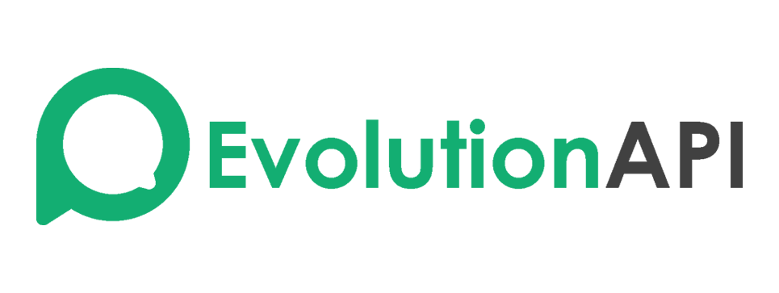

<h1 align="center">Evolution Api</h1>

 

  

## WhatsApp-Api-NodeJs

This project is based on the [CodeChat](https://github.com/code-chat-br/whatsapp-api). The original project is an implementation of [Baileys](https://github.com/WhiskeySockets/Baileys), serving as a Restful API service that controls WhatsApp functions.  
The code allows the creation of multiservice chats, service bots, or any other system that utilizes WhatsApp. The documentation provides instructions on how to set up and use the project, as well as additional information about its features and configuration options.

## SSL

To install the SSL certificate, follow the **[instructions](https://certbot.eff.org/instructions?ws=other&os=ubuntufocal)** below.

# Note

This code is in no way affiliated with WhatsApp. Use at your own discretion. Don't spam this.

This code was produced based on the baileys library and it is still under development.

# Donate to the project.

#### PicPay

  

#### Buy me coffe - PIX

  
  
<b>CHAVE PIX (Telefone):</b> (74)99987-9409

 

## Deploy no Render

Esta API pode ser hospedada como um serviço independente e consumida por outros sistemas através da API HTTP e dos webhooks.

### Preparação

1. No Render, crie um **Blueprint** e conecte este repositório.
2. Selecione a branch `fix/build-validation` para validar esta versão antes de integrá-la à `main`.
3. O Render utilizará o arquivo `render.yaml` para criar o serviço Docker `evolution-api`.
4. Depois que o Render gerar a URL pública do serviço, configure as variáveis abaixo no painel do serviço.

### Variáveis obrigatórias no Render

- `SERVER_URL`: URL pública HTTPS do serviço, por exemplo `https://SEU-SERVICO.onrender.com`.
- `AUTHENTICATION_API_KEY`: crie uma chave longa, aleatória e exclusiva para produção. Guarde-a como segredo e não a coloque no código do seu outro projeto.

A configuração do Blueprint define `SERVER_PORT=10000`, o endpoint de saúde `/health` e um disco persistente montado em `/evolution/instances` para os dados de sessão. Não remova o disco nem altere seu ponto de montagem sem revisar onde a aplicação salva as sessões.

### Verificação após o deploy

1. Abra `https://SEU-SERVICO.onrender.com/health`. A resposta esperada é semelhante a `{"status":"ok"}`.
2. Consulte a documentação da API no endereço público do serviço para criar uma instância e conectar o WhatsApp.
3. Configure o webhook da instância para apontar para uma URL pública HTTPS do projeto que receberá os eventos. `localhost` só funciona entre processos na mesma máquina, não entre o Render e seu computador.

### Segurança

- Nunca use a chave de teste local em produção.
- Armazene a chave no gerenciador de segredos do Render e nas variáveis de ambiente do projeto consumidor.
- Não publique QR Codes, credenciais, tokens ou arquivos de sessão.
- O endpoint `/health` serve apenas para verificar se o serviço responde; ele não comprova que uma sessão do WhatsApp está conectada.

O workflow `.github/workflows/render-validation.yml` executa um build da imagem Docker nas atualizações desta branch e em pull requests direcionados à `main`. Ele valida a compilação, mas não publica nem faz deploy automaticamente.
